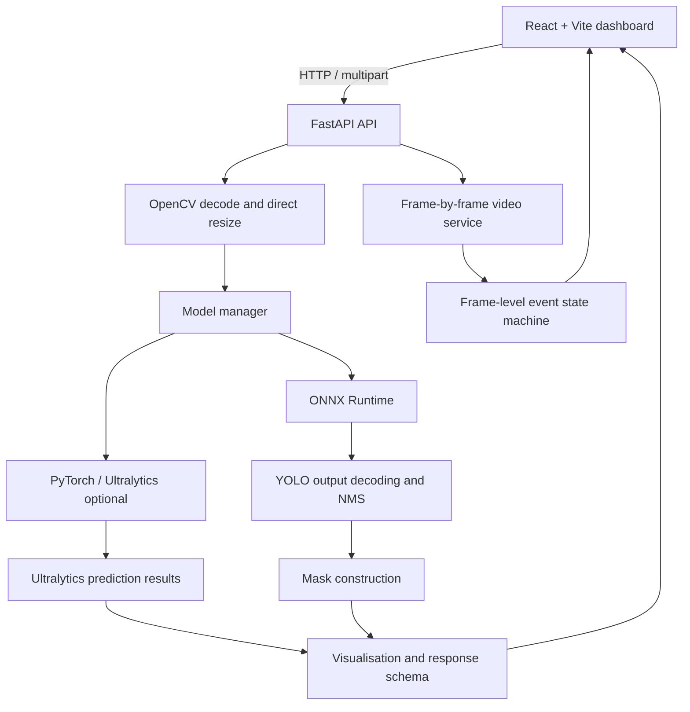

# RoadSight AI

RoadSight AI is a computer-vision portfolio project for detecting and segmenting pothole-like road defects in still images and processing road footage frame by frame. It combines a YOLOv8 segmentation model with a FastAPI service and a React dashboard.

The repository includes ONNX and PyTorch model artifacts, an image/video inference API, post-processing utilities, evaluation helpers and a small frontend for interacting with the API.

> **Project status:** This repository documents a locally runnable project. No hosted demo is documented here. Model results and performance figures should be treated as project-reported measurements unless they are accompanied by the dataset, run configuration and raw output needed to reproduce them.

## What it does

- **Image inference:** accepts an image, runs the selected model backend and returns detections, a combined mask, visual overlays and timing information.
- **Video processing:** processes video frames with OpenCV and returns frame-level summaries plus event records.
- **Segmentation post-processing:** decodes YOLOv8-seg outputs, applies confidence filtering and non-maximum suppression, and combines prototype masks.
- **Two inference options:** ONNX Runtime is the default path; the PyTorch/Ultralytics path is available when its optional dependencies are installed.
- **Runtime information:** exposes model metadata, health, basic in-process counters and an inference benchmark endpoint.
- **Web interface:** provides image analysis, video analysis, model information, benchmark results and API reference pages.

The video event processor is a lightweight **frame-level persistence state machine**. It aggregates detection count, average confidence and mask-area information across consecutive frames. It is not a per-object tracker and does not associate individual potholes using bounding-box IoU.

## Architecture



### Important implementation details

- Images are resized directly to the configured square input size (640 by default), converted from BGR to RGB, normalised to the 0–1 range and transposed to NCHW. This is a direct resize, not aspect-preserving letterboxing.
- The ONNX post-processing path expects a YOLOv8-seg style detection output and a prototype-mask output.
- The video processor emits event types such as `new_detection`, `persistent`, `high_confidence`, `large_area` and `lost` based on frame-level summaries.
- The configured upload-size limit is checked in the inference validation functions after the API route has read the uploaded payload into memory. It is not currently a streaming request-body limit.

For a component-by-component view, see [Architecture](docs/architecture.md).

## Technology

| Area | Technologies |
| --- | --- |
| Model | YOLOv8 instance segmentation |
| Inference | ONNX Runtime (CPU or CUDA provider when available); PyTorch/Ultralytics optional path |
| Image and video processing | OpenCV, NumPy |
| Backend | Python, FastAPI, Pydantic |
| Frontend | React 18, Vite, TypeScript, Tailwind CSS |
| Packaging | Docker and Docker Compose |
| Tests | Pytest, FastAPI TestClient |

## Repository layout

```text
RoadSight-AI/
├── backend/
│   ├── app/
│   │   ├── api/             # FastAPI routes
│   │   ├── core/            # Settings, model manager and post-processing
│   │   ├── schemas/         # API response schemas
│   │   ├── services/        # Image/video inference, events and benchmarks
│   │   └── utils/           # Input preprocessing and visualisation
│   ├── models/              # best.onnx and best.pt
│   ├── tests/
│   ├── Dockerfile
│   └── requirements.txt
├── frontend/
│   ├── src/
│   │   ├── pages/
│   │   ├── components/
│   │   └── services/
│   └── package.json
├── data/                    # Dataset layout and annotation guidance
├── docs/                    # Architecture, evaluation and deployment guides
├── scripts/                 # Evaluation, benchmarking and ONNX export
├── docker-compose.yml
└── README.md
```

## Run locally

### 1. Backend

The backend requirements install the ONNX inference path. The optional PyTorch backend requires additional packages (`torch` and `ultralytics`) that are not listed in `backend/requirements.txt`.

```bash
cd backend
python -m venv .venv

# Windows PowerShell
.venv\Scripts\Activate.ps1

# macOS / Linux
source .venv/bin/activate

pip install -r requirements.txt
# Optional, only when using MODEL_FORMAT=pytorch:
# pip install torch ultralytics

# Copy the root environment template into backend/.env
# Windows PowerShell: Copy-Item ../.env.example .env
# macOS / Linux: cp ../.env.example .env

uvicorn app.main:app --reload --host 0.0.0.0 --port 8000
```

### 2. Frontend

Open a second terminal:

```bash
cd frontend
npm ci
```

Create `frontend/.env.local` with the local API address:

```env
VITE_API_BASE_URL=http://localhost:8000
```

Then start the Vite development server:

```bash
npm run dev
```

Open [http://localhost:5173](http://localhost:5173). The API is available at [http://localhost:8000](http://localhost:8000), with interactive docs at [http://localhost:8000/docs](http://localhost:8000/docs).

For Docker and hosted-environment notes, see [Deployment](docs/deployment.md).

## API overview

All application routes use the `/api/v1` prefix.

| Method | Endpoint | Purpose |
| --- | --- | --- |
| GET | `/api/v1/health` | API and model-loaded status |
| GET | `/api/v1/model` | Loaded model metadata |
| POST | `/api/v1/predict/image` | Image detection, segmentation and visualisations |
| POST | `/api/v1/predict/video` | Frame-by-frame video processing and event summaries |
| GET | `/api/v1/predict/video/{video_id}/download` | Download a processed video while its temporary file exists |
| GET | `/api/v1/benchmark` | Run an inference-engine benchmark |
| GET | `/api/v1/metrics` | In-memory counters for the current API process |
| GET | `/api/v1/system` | Runtime and dependency information |

The metrics endpoint is process-local and resets when the API process restarts. It is not a persistent monitoring system.

## Tests and quality checks

Run backend tests from the repository root after activating the backend virtual environment:

```bash
python -m pytest backend/tests -v
```

Run frontend checks from `frontend/`:

```bash
npm run lint
npm run build
```

Record the actual output from your environment. The README intentionally does not publish a fixed test count or claim that tests pass in every environment.

## Evaluation and benchmarking

The repository contains two distinct tools:

- `scripts/evaluate.py` compares predicted binary masks with paired ground-truth PNG masks and calculates mask IoU, Dice, pixel-level precision/recall/F1 and relative area error. It does **not** calculate detection mAP.
- `scripts/benchmark.py` measures model inference using a generated synthetic input image. The current implementation compares ONNX Runtime and PyTorch/Ultralytics when the relevant model and dependencies are available. It does not implement INT8 quantization or TensorRT benchmarking.

See [Model evaluation](docs/model-evaluation.md) for the exact input format and commands. Do not compare benchmark figures unless the model artifact, runtime/provider, hardware, warm-up count, iteration count and input conditions are recorded.

## Data and model notes

The repository contains dataset preparation guidance, not a complete training or evaluation dataset. Do not assume that a dataset named in the guidance was used to train or validate the checked-in weights.

Before publishing model metrics, record:
- Dataset name, version, source and licence.
- Train/validation/test split and image count.
- Annotation format and class mapping.
- Model checkpoint and inference settings.
- Evaluation command and raw output.
- Hardware and software versions for latency measurements.

See [Dataset guide](data/README.md).

## Current limitations to keep in mind

- The default preprocessing path stretches each image to a square input; aspect ratio is not preserved.
- The event processor summarises frame-level detections rather than tracking individual defect instances.
- The evaluator compares binary masks and does not calculate box or mask mAP.
- The benchmark uses generated synthetic input and measures the inference engine, not the full upload-to-response pipeline.
- Upload validation checks configured size and extension after the request handler has read the uploaded payload into memory.
- The optional PyTorch path needs dependencies beyond the default backend requirements.

These are useful areas for future engineering work and should be considered when interpreting results.

## License and attribution

See [LICENSE](LICENSE) for the repository license. The project uses the Ultralytics YOLO ecosystem; review the applicable model and dependency licences before redistribution or commercial use.
