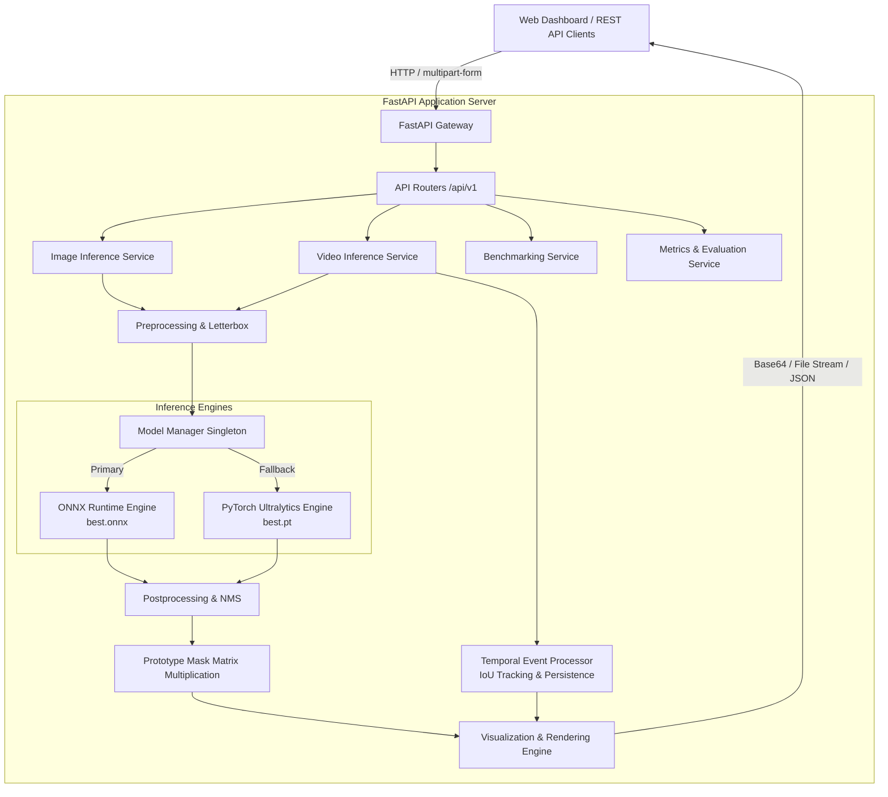
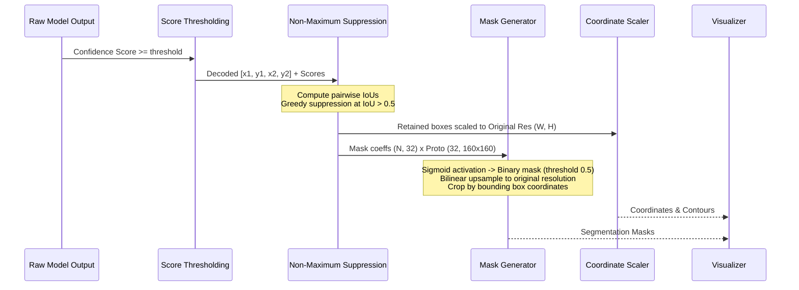

# RoadSight AI — System Architecture & Design Documentation

## 1. Executive Summary

RoadSight AI is a production-grade Computer Vision and Video Analytics system engineered to detect, segment, and track road surface defects (primarily potholes) from images and dashcam video feeds. 

Unlike toy detection projects, RoadSight AI features:
- **Dual-backend inference engine**: Optimized ONNX Runtime with CPU/CUDA execution providers alongside a PyTorch (Ultralytics) fallback.
- **Instance segmentation pipeline**: Custom NMS, box decoding, and tensor-multiplication prototype mask generation.
- **Temporal defect tracking**: Temporal persistence filtering and spatial IoU association across video frames to eliminate transient false positives.
- **Microservice-ready REST API**: High-throughput FastAPI service with structured Pydantic V2 schemas, lifespan management, and runtime resource profiling (`psutil`).
- **High-performance dashboard**: React 18 + Vite + Tailwind CSS dashboard providing visual overlays, severity heatmaps, benchmark analytics, and Swagger API documentation.

---

## 2. High-Level System Architecture

---

## 3. Computer Vision Pipeline Deep Dive

### 3.1 Preprocessing Pipeline
Input images can arrive in arbitrary resolutions and formats (JPEG, PNG, WebP, BMP).

1. **Decoding & Validation**: Byte stream verified and decoded via `cv2.imdecode` into BGR NumPy array. Integrity checks reject corrupt payloads or zero-byte files.
2. **Color Conversion**: BGR $\rightarrow$ RGB.
3. **Resizing & Letterboxing**: Scaled to model input dimensions ($640 \times 640$) while maintaining aspect ratio, zero-padded with standard neutral padding (114) when necessary.
4. **Normalization & Permutation**:
   $$\mathbf{X}_{\text{tensor}} = \frac{\mathbf{X}}{255.0} \in [0.0, 1.0]^{1 \times 3 \times 640 \times 640}$$
   Axes transposed from HWC $\rightarrow$ CHW and batched along dimension 0.

### 3.2 Model Inference
The YOLOv8-seg architecture outputs two primary tensors:
1. **Output 0 (Detection + Mask Coefficients)**: Shape `[1, 37, 8400]`:
   - 4 box coordinates $(x, y, w, h)$ in input coordinate space.
   - 1 class confidence score ($p_{\text{pothole}}$).
   - 32 mask prototype coefficients ($c_1, \dots, c_{32}$).
2. **Output 1 (Proto-mask feature maps)**: Shape `[1, 32, 160, 160]`:
   - 32 spatial prototype feature maps at $1/4$ resolution ($160 \times 160$).

### 3.3 Postprocessing & Non-Maximum Suppression (NMS)

1. **Box Decoding**: Center coordinates $(x_c, y_c, w, h)$ converted to corner coordinates:
   $$x_1 = x_c - \frac{w}{2}, \quad y_1 = y_c - \frac{h}{2}, \quad x_2 = x_c + \frac{w}{2}, \quad y_2 = y_c + \frac{h}{2}$$
2. **IoU Calculation & NMS**:
   $$\text{IoU}(A, B) = \frac{\text{Area}(A \cap B)}{\text{Area}(A \cup B)}$$
   Boxes sorted by confidence score descending. Iterative suppression suppresses overlapping candidates with $\text{IoU} > 0.5$.
3. **Mask Synthesis**:
   $$\mathbf{M}_{\text{proto}} = \sigma\left(\sum_{k=1}^{32} c_k \cdot \mathbf{P}_k\right) \in [0.0, 1.0]^{160 \times 160}$$
   Masks are then upsampled back to the original image dimensions via bilinear interpolation, cropped by their respective bounding box bounds, and binarized at $\tau = 0.5$.

---

## 4. Temporal Defect Tracking & Video Analytics

Real-world dashcam video features camera vibration, motion blur, and fleeting background artifacts. Single-frame detectors frequently produce one-frame false alarms or intermittent flicker.

RoadSight AI incorporates a **Temporal Event Processor**:
- **Spatial Tracking**: Associates detected defects across consecutive frames using bounding-box IoU matching ($T_{\text{match}} \ge 0.3$).
- **Persistence Thresholding**: A detected defect is only marked as a verified road hazard once tracked across at least $N_{\text{persist}} = 3$ consecutive frames.
- **Severity Indexing**: Computes hazard severity based on:
  $$\text{Severity} = w_1 \cdot \text{AreaRatio} + w_2 \cdot \bar{c} + w_3 \cdot \text{Duration}$$
  Categorized as Low, Moderate, or Critical.
- **Event Timeline Generation**: Outputs structured timestamped records with first detected frame, last seen frame, peak confidence, and total screen occupancy area.

---

## 5. Benchmarking & Runtime Profiling

The service includes an on-demand runtime benchmark endpoint:
- Evaluates cold vs. warm latency across $N$ iterations.
- Captures P50, P90, P99, Mean, and Min/Max inference latencies.
- Measures hardware metrics using `psutil`:
  - Resident Set Size (RSS) RAM usage.
  - CPU utilization percentage.
  - Active execution provider (`CPUExecutionProvider` or `CUDAExecutionProvider`).

---

## 6. Security & Production Engineering

1. **Resource Bounds**: File upload limits (50MB) and maximum video frames (500 frames) prevent Denial of Service (DoS) and memory exhaustion.
2. **Memory Safety**: Video frames are processed in streaming generator fashion using OpenCV without buffering entire video streams into system RAM.
3. **Path Traversal Protection**: File download endpoints sanitize input identifiers using strict alphanumeric and delimiter whitelists.
4. **Decoupled Architecture**: Backend operates entirely independently as a stateless RESTful service, enabling horizontal scaling behind a load balancer.
