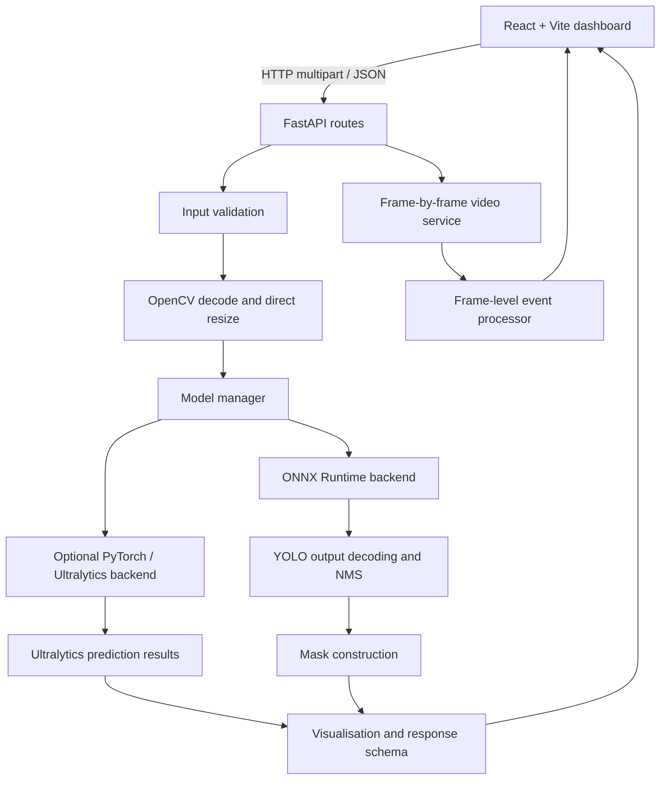

# Architecture overview

This document explains the main components in the current RoadSight AI repository and how image and video requests move through the application.

## System view

This is a logical view of the code. Optional backends and execution providers depend on the packages and hardware available in the runtime.

## Frontend

The frontend is a React 18 single-page application built with Vite, TypeScript and Tailwind CSS.

| Location | Responsibility |
| --- | --- |
| `frontend/src/pages/` | Home, image analysis, video analysis, benchmark, model information and API pages |
| `frontend/src/components/` | Shared layout and dashboard components |
| `frontend/src/services/api.ts` | HTTP client used by the UI |
| `frontend/src/types/` | TypeScript types for API data |

The frontend sends image and video uploads to the FastAPI API. The API base URL is configured through the Vite environment variables.

## Backend

The FastAPI application is under `backend/app/`.

| Location | Responsibility |
| --- | --- |
| `api/routes.py` | Health, model, image, video, benchmark, metrics, system and video-download endpoints |
| `core/config.py` | Environment-driven settings and model/input paths |
| `core/model.py` | ONNX Runtime and optional PyTorch model backends |
| `core/postprocessing.py` | ONNX output decoding, confidence filtering, NMS and mask construction |
| `services/image_inference.py` | Image inference pipeline |
| `services/video_inference.py` | Video frame loop, annotated output and event aggregation |
| `services/events.py` | Frame-level persistence/event state machine |
| `services/benchmark.py` | Synthetic-input model-inference benchmark |
| `services/metrics.py` | Binary-mask evaluation functions |
| `utils/preprocessing.py` | Image/video input validation and image preprocessing |
| `utils/visualization.py` | Detection overlays and mask visualisations |
| `schemas/responses.py` | Pydantic response contracts |

## Image request flow

1. The browser submits a multipart image request to `POST /api/v1/predict/image`.
2. The route reads the uploaded file and calls the image inference service.
3. Input validation checks that the payload is non-empty, within the configured size limit and has an allowed filename extension.
4. OpenCV decodes the image into a BGR array.
5. Preprocessing resizes the image directly to the configured square model dimensions, converts BGR to RGB, normalises pixel values and converts HWC to NCHW.
6. The model manager runs the selected ONNX or PyTorch backend.
7. The ONNX path decodes detection outputs, applies confidence filtering and NMS, then constructs a combined binary mask from the mask coefficients and prototype output.
8. The service returns structured detection data and base64-encoded visualisations.

**Preprocessing note:** the current implementation uses `cv2.resize` to force the configured square size. It does not perform letterboxing, so non-square input images are geometrically resized.

**Upload note:** the configured file-size check occurs after the route has read the uploaded payload into memory. A streaming/body-level limit would be a separate hardening improvement.

## Video request flow

1. The browser submits a multipart video request to `POST /api/v1/predict/video`.
2. The route reads the video payload and validates the extension and configured size.
3. The video service writes the input to a temporary file and opens it with OpenCV.
4. Frames are read sequentially. The configured frame-skip setting determines which frames are passed to inference, and the configured maximum bounds the number of processed frames.
5. For each processed frame, the selected model backend produces detections and an annotated frame.
6. The event processor receives aggregate values for that frame: detection count, average confidence and area ratio.
7. The response includes per-frame summaries, generated events and a temporary processed-video identifier. The download route serves the processed video while its temporary output file remains available.

The event processor does **not** perform per-instance object tracking. It maintains one aggregate detection state, counts consecutive frames with detections, and emits persistence/high-confidence/large-area/lost events from frame-level summaries.

## Model selection

The model manager uses `MODEL_FORMAT`:

- `onnx` (default): loads `MODEL_PATH` from the configured model directory and creates an ONNX Runtime session. CUDA is selected when the CUDA execution provider is available; CPU is also configured.
- `pytorch`: loads the corresponding `.pt` checkpoint through Ultralytics. This path requires `torch` and `ultralytics`, which are not part of the default backend requirements file.

The model artifacts currently present in the repository are `backend/models/best.onnx` and `backend/models/best.pt`.

## Evaluation and benchmarking

These are different workflows:

- The evaluator compares combined predicted masks with paired binary ground-truth masks and reports mask-level overlap metrics. It does not calculate mAP.
- The benchmark uses a generated synthetic input and times model inference calls for available ONNX Runtime and PyTorch backends. It does not measure the complete HTTP or video pipeline.

See [Model evaluation](model-evaluation.md) for commands and reporting requirements.

## Runtime and deployment considerations

- Model loading happens during FastAPI application startup.
- The API's metrics counters are in-memory and process-local.
- Video outputs are stored temporarily and are not a persistent media library.
- Each additional server worker can load its own model copy; size memory accordingly.
- Use development-only credentials and avoid committing environment files.
